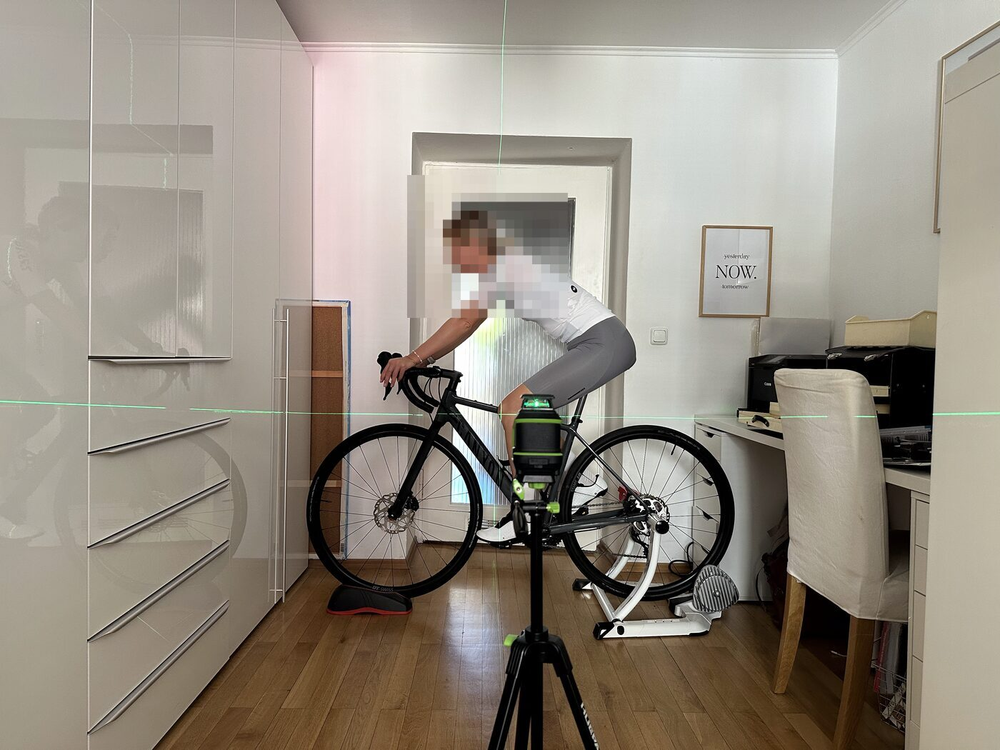

# bikefit-muc.de — Website Mobile BikeFit München

Statische Seite, gehostet auf GitHub Pages unter der eigenen Domain **bikefit-muc.de**.
Kein Framework, kein Build-Schritt, keine Abhängigkeiten: was hier im Repo liegt, ist genau das,
was ausgeliefert wird. Bearbeiten heißt: Datei ändern, committen, pushen — nach ein bis zwei
Minuten ist es online.

## Dateien

| Datei | Zweck |
|---|---|
| `index.html` | Die komplette Startseite mit allen Abschnitten. |
| `impressum.html` | Pflichtangaben nach § 5 DDG. |
| `datenschutz.html` | Bisher nur die Gliederung, der ausformulierte Text fehlt noch (siehe unten). |
| `styles.css` | Das gesamte Aussehen, mobil zuerst, ab 800 px das Desktop-Layout. |
| `assets/logo-mark.png` | Bildmarke im Seitenkopf (dunkle Linien auf Transparenz). |
| `assets/favicon.*` | Browser-Tab-Symbol und Startbildschirm-Icon (weiße Marke auf Terracotta). |
| `assets/og-titelbild.jpg` | Vorschaubild, wenn jemand den Link in WhatsApp o. Ä. teilt. |
| `assets/fonts/` | Schrift Manrope, lokal eingebettet (SIL Open Font License, `OFL.txt`). |
| `CNAME` | Sagt GitHub Pages, unter welcher Domain die Seite läuft. Nicht löschen. |
| `.nojekyll` | Schaltet Jekyll ab; sonst würde GitHub Ordner mit Unterstrich ignorieren. |

Quelle der Texte und des Entwurfs ist das Haupt-Repo `bikefit`:
`docs/website/inhalt.md` und `docs/website/mockup/`.

## Was sich regelmäßig ändert

**Einführungspreis-Zähler.** In `index.html` im Abschnitt „Preise“ steht

```html
Noch <b>10</b> von 10.
```

Nach jedem vergebenen Einführungs-Fitting die Zahl um eins verringern. Bei 0 den ganzen Block
`<div class="aktion"> … </div>` entfernen. Über der Zeile steht derselbe Hinweis noch einmal als
Kommentar.

**Fotos.** Es gibt drei Platzhalterflächen (Foto 1 Setup, Foto 2 Laptop mit Overlay, Foto 3
Porträt). Ein Platzhalter sieht so aus:

```html
<div class="foto-platz foto-hero" role="img" aria-label="Platzhalter für Foto 1: …">
  <p>Foto 1 – Setup beim Kunden:<br>…</p>
</div>
```

Zum Ersetzen den ganzen Block durch ein Bild tauschen und die Klasse behalten, damit das
Seitenverhältnis stimmt:

```html

```

`width`/`height` immer mitangeben (sonst springt das Layout beim Laden), Bilder vorher auf
maximal ~1600 px Kantenlänge verkleinern und als JPEG mit Qualität ~80 speichern. Der `alt`-Text
beschreibt, was zu sehen ist — er ersetzt das Bild für Screenreader und wenn es nicht lädt.

## Was bewusst fehlt

- **Datenschutztext.** `datenschutz.html` enthält nur die Gliederung und pro Abschnitt den
  Vermerk „Text folgt“. Das ist Absicht: die Formulierungen sollen aus einem Generator kommen
  (z. B. e-recht24) und gegen die Punkte in `docs/website/inhalt.md` geprüft werden, nicht frei
  erfunden sein.
- **Google-Bewertungslink.** In der Fußzeile steht „Google-Bewertungen (folgt)“ als reiner Text.
  Sobald das Unternehmensprofil live ist, den Kommentar direkt darüber in `index.html` durch den
  echten Link ersetzen.

## Datenschutz im Aufbau

Die Seite lädt **nichts von fremden Servern**: keine Cookies, kein Tracking, keine eingebetteten
Karten, kein Google Fonts (die Schrift liegt unter `assets/fonts/`). Deshalb braucht sie auch
keinen Cookie-Banner. Das bleibt nur so, wenn nichts Externes nachträglich eingebunden wird —
ein einziges `<script src="https://…">` oder ein eingebettetes Video kippt diese Aussage und
damit auch den Datenschutztext.

## Farben und Marke

Terracotta `#D97757` und Creme `#FBFAF8` sind dieselben Werte wie im Analyse-Tool
(`bikefit`-Repo, `assets/brand/README.md`). Für Text auf Terracotta benutzt die Seite einen
tieferen Ton (`--terracotta-tief`, `#B85334`) — weißer Text auf dem hellen Terracotta erreicht
nur 3,1:1 Kontrast und wäre für Menschen mit eingeschränkter Sehkraft schwer zu lesen. Die
Begründung steht ausführlich im Kopf von `styles.css`.

## Veröffentlichen

GitHub Pages baut aus dem Branch `main`, Ordner `/` (root). Ein `git push` genügt; es gibt keinen
Build-Schritt, der schiefgehen könnte.

Lokal ansehen (nicht per Doppelklick öffnen — dann laden die Schriften nicht):

```bash
python3 -m http.server 8765
```

Danach `http://127.0.0.1:8765/` im Browser aufrufen.
